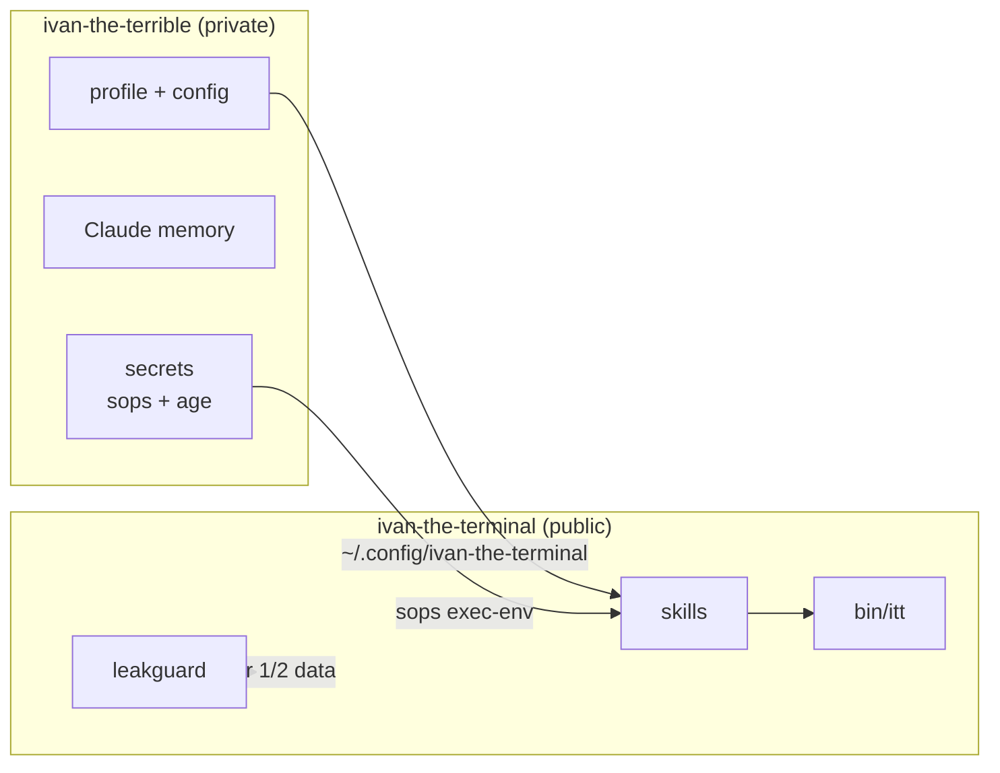

# ivan-the-terminal

> A self-hosted copilot that lives in my terminal. Claude Code skills that keep my home infrastructure in order, my retro game library playable and streamable, my job search moving and my health on track, plus civic tools anyone can use. Each one is built to replace a subscription.

> 🆕 **[Подай глобата](https://zdravkov.dev/podai-globata)**: photograph a wrongly parked car in Bulgaria, and Claude writes the formal report to the right authority, with GPS, address, plate and the article of the law. A free, open-source Claude skill that runs on your phone. [Bulgarian page](plugins/civic/skills/podai-globata/README.md) · [English](plugins/civic/skills/podai-globata/README.en.md)

The name? Ivan the Terrible had secrets. This repo is **Ivan the Terminal**: everything that's safe to share. The secrets live in a private sibling.

## Why

- **Own the stack.** Every skill replaces a paid, ad-driven or enshittified service with something local, scriptable and mine.
- **Lean on tokens.** Skills are short, push deterministic work into scripts with terse output, and load details only on demand. ([conventions](docs/skill-authoring.md))
- **Private by construction.** Public skills are generic. Personal values are injected at runtime from a private overlay, and a multi-layer guard stops anything personal from reaching this repo.

## How it fits together



| Tier | Where | Examples |
|---|---|---|
| 0 · public | this repo | skills, scripts, docs, ideas |
| 1 · private | overlay repo | family, schedules, addresses, network topology, devices, paths |
| 2 · encrypted | overlay, sops+age | API keys, passwords, tokens |

## Leak defence in depth

| Layer | When | What |
|---|---|---|
| Claude `PreToolUse` hook | before Claude writes a file here or runs `gh pr/issue/…` | leakguard on the content |
| `pre-commit` / `commit-msg` | every commit | leakguard (staged lines, message) + gitleaks |
| `pre-push` | before anything leaves the machine | leakguard on every outgoing commit + gitleaks on full history; direct pushes to `main` refused |
| `ship-public` skill | every change | `itt ship-check` + `/security-review` before the first push |
| CI (`guard.yml`) | every PR, required to merge | leakguard (tree, every commit, PR text) with the private denylist from an encrypted secret, gitleaks, tests |
| GitHub | always | protected `main`, secret scanning + push protection, read-only Actions token, pinned actions |

[leakguard](tools/leakguard/leakguard.py) is a dependency-free Python scanner with two parts. Generic rules catch IPs, MACs, phone numbers, home paths, tailnet names, private keys, IBANs, coordinates and image EXIF. A **private denylist** covers names, places, serials, and sha256-hashed secrets, so even the denylist never stores credentials in plaintext. See [SECURITY.md](SECURITY.md).

## Plugins

| Plugin | Skill | What it does | Status |
|---|---|---|---|
| 🆕 **[civic](plugins/civic)** | **[`podai-globata`](plugins/civic/skills/podai-globata/README.md)** | Подай глобата: photos of a wrongly parked car in Bulgaria → a formal report to the right authority, from the phone ([zdravkov.dev/podai-globata](https://zdravkov.dev/podai-globata)) | ✅ |
| [foundation](plugins/foundation) | [`doctor`](plugins/foundation/skills/doctor) | health-check of the whole setup: toolchain, auth, git hooks, leak guards, overlay | ✅ |
|  | [`new-machine`](plugins/foundation/skills/new-machine) | set up or migrate the environment onto a fresh Linux machine | ✅ |
|  | [`ship-public`](plugins/foundation/skills/ship-public) | safe publishing: branch, leak scan, gitleaks, tests, security review, PR, auto-merge | ✅ |
|  | [`kaizen`](plugins/foundation/skills/kaizen) | continuous-improvement pass after every task | ✅ |
| [homelab](plugins/homelab) | [`homelab-check`](plugins/homelab/skills/homelab-check) | daily machine health check with notifications: updates, disks, SMART, mounts, services, tailnet | ✅ |
|  | [`system-updates`](plugins/homelab/skills/system-updates) | updates across every layer of an atomic Fedora / Bazzite machine | ✅ |
|  | [`tv`](plugins/homelab/skills/tv) | Android TV over adb: apps from official sources, weekly updates | ✅ |
| [career](plugins/career) | [`job-digest`](plugins/career/skills/job-digest) | headless weekday run, no sending; ranked digest in a phone app with push and marks | ✅ |
| [retro](plugins/retro) | [`rom-library`](plugins/retro/skills/rom-library) | audit the ROM library: CHD/RVZ, playlists, 50 Hz, duplicates | ✅ |
|  | [`rom-sync`](plugins/retro/skills/rom-sync) | mirror systems to a device over adb or to an SD card | ✅ |
| [health](plugins/health) | [`daily-coach`](plugins/health/skills/daily-coach) | ring/Apple Health → a tiny gamified daily plan in a phone app with push, check-ins, XP, trends, seasonal recipe | ✅ |
| kitchen | chef | seasonal, locally available recipes, pantry-aware ([roadmap](docs/roadmap.md)) | 📝 ToDo |
| training | training buddy | progressive overload plans and calendar events ([roadmap](docs/roadmap.md)) | 📝 ToDo |

## Use it

```bash
# as a Claude Code plugin marketplace
/plugin marketplace add ivan-zdravkov/ivan-the-terminal
/plugin install foundation@ivan-the-terminal

# or the full setup (Linux + Homebrew)
gh repo clone ivan-zdravkov/ivan-the-terminal ~/Repositories/ivan-the-terminal
~/Repositories/ivan-the-terminal/bin/itt bootstrap && itt doctor
```

Without a private overlay everything runs in generic mode. To make it yours, create your own overlay repo and point `ITT_PRIVATE_REPO` at it.

Built on Linux (Bazzite, atomic Fedora) with [Claude Code](https://claude.com/claude-code). MIT licensed.
